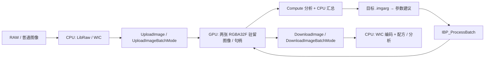

# ImageBatchProcessor

**基于 Vulkan Compute 的 Windows RAW 批处理引擎、命令行工具与桌面编辑器。**

ImageBatchProcessor 将图像解码、GPU 驻留处理、统计分析、目标参数匹配和文件导出组织为可复用的流水线。核心库提供 C ABI 与 C++ RAII 包装。新的 **Studio 编辑器使用 C++ / Dear ImGui / SDL3 / Vulkan**，提供滑块、可拖动曲线和 GPU 预览；命令行工具适合批量任务和配方重放。原 C# / WinForms 前端保留为兼容工具。

[下载 Windows x64 发行版](https://github.com/Chilliziehen/ImageBatchProcessor/releases/latest) · [二进制格式](FORMAT.md) · [处理算法](docs/ALGORITHMS.md) · [验证记录](QA_RESULTS.md) · [参考文献](#references)

> 当前版本：**1.1.0**。面向 Windows x64 / Vulkan 1.1；实际验证设备为 Intel Arc。Studio 的窗口与渲染依赖可跨平台，但 Core 的 WIC 文件 I/O 尚未移植，当前发行版仍限 Windows。项目不把自动参数建议视为主观审美评分，也不宣称覆盖商业 RAW 编辑器的全部功能。

## 目录

- [快速开始](#quick-start)
- [功能范围](#features)
- [构建与打包](#build)
- [架构与资源生命周期](#architecture)
- [颜色空间与统计约定](#color)
- [图像分析：23 项指标与计算公式](#metrics)
- [目标匹配与配方重放](#matching)
- [核心处理算法](#processing)
- [API 与文件格式](#api)
- [验证、性能与限制](#validation)
- [许可证与参考文献](#references)

<a id="quick-start"></a>
## 快速开始

从 [Releases](https://github.com/Chilliziehen/ImageBatchProcessor/releases) 下载 `ImageBatchProcessor-1.1.0-win-x64.zip`，完整解压后运行：

- 新编辑器：`bin/ImageBatchProcessorStudio.exe`，支持将照片或目录拖入窗口。
- 旧版兼容界面：`gui/ImageBatchProcessorGui.exe`（使用 v1 配方）。
- 命令行：`bin/imgbp.exe`。
- 默认目标：发行包根目录的 `natural.imgarg`。
- 开发接口：`include/` 和 `lib/`。

运行发行版需要支持 Vulkan 1.1、RGBA32F storage / sampled image 的显卡驱动。Studio 为原生程序，无需 .NET；兼容 GUI 包含 .NET 运行时。普通图像处理不需要安装 Vulkan SDK；自行重新编译 Shader 时才需要 `glslc`。请保留 EXE / DLL 附近的 `shaders/` 目录。

### Studio 操作

- 中央画布支持滚轮缩放、空格拖动、适应窗口，以及可拖动分界线的前后比较；按住 `\` 临时看原图。
- 调整面板提供滑块和数值框：双击滑块重置，拖动数值微调，Ctrl+单击数值直接输入。
- 曲线支持亮度及 RGB 四通道、点击加点、拖动节点、右键删除内部节点；曲线下方显示选中节点坐标，最多 32 点/通道。
- 每张照片独立保存参数与历史，`Ctrl+Z` / `Ctrl+Y` 撤销重做；一次滑块或节点拖动形成一条历史。历史最多 80 步，重启只恢复最终参数。
- 胶片栏支持 Ctrl+单击多选。配方菜单可以复制、粘贴、同步到选中照片，或保存可由 CLI 重放的 `.imgarg`。
- 导出使用每张照片当前参数及原始尺寸，后台输出 JPEG / 16 位 TIFF / PNG，并附 v2 配方。已有图片不覆盖；取消在当前照片完成后生效。

预览最长边为 **2048 像素**；“预览 100%”指预览纹理像素，不是 RAW 原始像素。解码与导出在后台执行，GPU 预览调用同步返回，拖动时最多约每 40 ms 请求一次更新。细节、降噪和几何应以全尺寸导出复核。布局和每张照片最终参数存储在 SDL 用户配置目录；原照片保持不变。详细设计及限制见 [Studio 工作流](docs/STUDIO.md)。

在解压目录打开 PowerShell：

```powershell
# 查看设备并运行 GPU 合同检查
.\bin\imgbp.exe device
.\bin\imgbp.exe selftest

# 生成默认目标，或根据参考图像建立统计目标
.\bin\imgbp.exe target --output custom.imgarg
.\bin\imgbp.exe target --reference reference.jpg --output reference.imgarg

# 按目标批量处理 RAW；默认为全尺寸 JPEG、质量 95
.\bin\imgbp.exe batch --input .\Raw --output .\Raw_Out --target .\natural.imgarg --batch-size 2 --resume

# 同时导出 JPEG 与 16 位 TIFF
.\bin\imgbp.exe batch --input .\Raw --output .\Export --format both

# 生成预览及处理前对照；覆盖自动建议中的指定参数
.\bin\imgbp.exe batch --input photo.NEF --output .\Preview --preview 1600 --before --set exposure=0.3

# 使用原始输入重放某张照片的最终配方
.\bin\imgbp.exe batch --input photo.NEF --output .\Replay --target photo.imgarg --fixed

# 分析原始解码图像
.\bin\imgbp.exe analyze --input photo.NEF --output analysis.json
```

目录模式筛选 RAW 扩展名；显式指定单个文件时也支持 WIC 可解码的 JPEG、PNG、TIFF。相机型号与压缩变体支持取决于固定版本的 LibRaw，扩展名匹配不代表所有同扩展名文件均可解码。路径支持 Unicode。

| 选项 | 含义 |
| --- | --- |
| `--target PATH` | 读取 `.imgarg`；省略时使用内置自然目标 |
| `--fixed` | 使用配方内参数，跳过自动建议 |
| `--set name=value` | 覆盖对应参数，可重复；执行于建议或固定配方加载之后 |
| `--format jpg\|tif\|png\|both` | 输出格式；TIFF / PNG 为每通道 16 位 RGB |
| `--quality N` | JPEG 质量；编码端限制到 1–100，默认 95 |
| `--batch-size N` | CLI 批次大小 1–8，默认 2；内存紧张时选 1 |
| `--recursive` | 递归输入目录，并保留相对目录结构 |
| `--preview N` | 半尺寸 RAW 解码后按最长边缩小；与全尺寸统计/细节结果可能不同 |
| `--before` | 额外导出未经过 GPU 调整的解码对照 JPEG |
| `--limit N` / `--stride N` | 按路径排序后限制数量 / 每 N 个文件取一个；不是分析采样步长 |
| `--resume` | 已存在主图、配方及前后分析文件时跳过；`both` 还要求 TIFF 存在 |

每张结果包含 `photo.jpg`、`photo.imgarg`、`photo.input.json`、`photo.analysis.json`。图像输出禁止覆盖，先写同目录临时文件，成功编码后再重命名。侧车文件不是整体事务的一部分；中途失败可能留下部分产物。`--resume` 检查文件存在性，不验证参数是否相同或文件 CRC；更换目标、版本或处理设置时应使用新输出目录。批处理中存在失败项时返回非零退出码，并在 `batch.log` 记录。

<a id="features"></a>
## 功能范围

| 模块 | 实现 |
| --- | --- |
| 光线与色调 | 线性曝光、阴影/高光 EV、黑白点、对比度、Gamma、柔性高光肩部 |
| 色彩 | RGB 白平衡增益、全局色相/饱和度/自然饱和度、8 区 HSL、亮度及 RGB 曲线（旧接口 17 点；Studio 最多 32 控制点 / 1024 项 LUT）、3×3 通道混合、分离色调、黑白 |
| 局部调整 | 径向、线性渐变、亮度蒙版；羽化、反选、局部曝光和饱和度 |
| 细节与效果 | 5×5 双边降噪、阈值锐化、稀疏邻域局部对比度、对比度式去雾、暗角、确定性颗粒 |
| 几何 | 逆向 Panini 重投影、水平视角、旋转、透视、径向 k1/k2、中心缩放、红蓝通道径向色差 |
| 分析 | 4×256 直方图、23 项统计量、有效样本数、JSON 导出 |
| 工作流 | 驻留句柄、批次提交、目标参数建议、版本化二进制配方、固定参数重放 |

功能分类参考 darktable 官方处理模块目录 [6]。这些类别不意味着与其同名模块采用相同实现。完整参数索引见 [FORMAT.md](FORMAT.md)；GUI 暴露常用调整，完整参数表可通过核心 API 访问。

<a id="build"></a>
## 构建与打包

### 依赖

| 组件 | 要求 / 本地验证版本 |
| --- | --- |
| 系统与编译器 | Windows x64；Visual Studio 2022 C++ 工具链；C++20 |
| 构建系统 | CMake ≥ 3.24 |
| GPU 开发工具 | Vulkan SDK，含 `glslc`；已验证 1.4.321.1，Shader 目标 Vulkan 1.1 |
| RAW 解码 | LibRaw 0.21.5，固定提交 `e8b172e2197c3d45b35ffa992f6cfd9c49fdc100` |
| Studio | Dear ImGui v1.92.9b-docking、SDL 3.2.30，固定 Git 子模块 |
| 兼容 GUI | .NET 9 Windows Desktop SDK；仅打包旧界面时需要 |
| 数值验证 | Python 3、NumPy；报告工具另需 Pillow |
| 可选 | OpenMP：CMake 检测到时启用对应编译/链接支持 |

`external/LibRaw`、`external/imgui`、`external/SDL` 是固定提交的 Git 子模块。GitHub 自动生成的源码 ZIP 不含子模块内容；推荐递归克隆，或者下载 Release 中带依赖的源码包。仅构建 Core / CLI 时可设置 `-DIBP_BUILD_STUDIO=OFF`。

```powershell
git clone --recurse-submodules https://github.com/Chilliziehen/ImageBatchProcessor.git
cd ImageBatchProcessor
# 对普通 clone 补充依赖：
git submodule update --init --recursive

cmake -S . -B build -G "Visual Studio 17 2022" -A x64
cmake --build build --config Release --parallel
ctest --test-dir build -C Release --output-on-failure
python -m pip install numpy
python tests/integration.py
python tests/editor_core.py

# 构建、安装并生成包含 GUI 的发行目录
powershell -ExecutionPolicy Bypass -File tools/package.ps1
```

`tools/package.ps1` 输出 `dist/`，包含原生程序、离线 SPIR-V、开发头文件、import library、自包含 GUI 和许可证。脚本需要构建依赖已安装，不自动安装全局 SDK。该版本 GUI 的项目引用以 `build/bin/Release` 和 `build/shaders` 为约定目录。

发布维护者可使用 `tools/package.ps1 -OutputDirectory dist-1.1.0`，提交源码后运行 `python tools/release_assets.py --version 1.1.0 --dist dist-1.1.0`。后者要求干净工作树，生成程序 ZIP、含固定子模块的源码 ZIP、逐文件 manifest 与 SHA-256 校验文件，不包含本地 QA 图像。

离线编译工具：

```powershell
.\dist\bin\imgbp-shaderc.exe ImageBatchProcessorCore/shaders/process.comp custom.spv
```

`glslc` 搜索顺序为 `IMGBP_GLSLC` 指定文件 → `VULKAN_SDK/Bin/glslc.exe` → `PATH` → 构建时路径。运行时 Core 直接加载 SPIR-V，不调用 GLSL 编译器。

<a id="architecture"></a>
## 架构与资源生命周期



### 模块职责

| 模块 | 职责 |
| --- | --- |
| `ImageBatchProcessorCore` | Vulkan 生命周期、驻留资源、Compute 调度、分析汇总、RAW/WIC I/O、C ABI、配方序列化 |
| `imgbp` | 文件选择、批次组织、参数覆盖、导出、续处理与日志 |
| `ShaderCompiler` | `imgbp-shaderc`：调用 `glslc` 离线生成 SPIR-V |
| `GUI` | C# WinForms，P/Invoke 调用 Core，预览、编辑与导出 |
| `Studio` | 原生 ImGui / SDL3 编辑器，共享 Vulkan 设备、驻留预览、历史和后台导出 |
| `tests` / `tools` | 数值验证、打包及离线结果检查工具 |

### 驻留与批次

上传返回 Context 内有效的 64 位句柄，每张图像保留两个 `VK_FORMAT_R32G32B32A32_SFLOAT` 图像并交替读写。后续多步调整不需要重新上传。重复调用处理会在当前结果上继续处理；希望从原图重新计算时，需要保留或重新上传原始解码数据。

每次处理调用创建一个 DescriptorPool，为每张图像分配两个 ping-pong descriptor set。所有参数存放于 SSBO，16 字节 PushConstant 传递 `imageIndex / passIndex / width / height`；`imageIndex` 索引参数，descriptor set 绑定当前图像。一个批次录制到同一 command buffer 并提交一次，逐图执行启用的 pass，尺寸可以不同。

当前采用 descriptor set 切换，**未启用 bindless / descriptor indexing**。处理 workgroup 为 16×16；分析为 256×1。处理 API 接受 1–64 张，CLI 进一步限制为 1–8 张。

### 队列与同步

- 自动选择可 Compute 的设备，优先独立显卡，其次集成显卡；当前没有设备选择 CLI 参数。
- 上传/下载优先 transfer-only queue family，找不到时退回 graphics family，再退回 compute family。
- 不同 queue family 共享的图像采用 concurrent sharing；提交间通过交替 binary semaphore 建立依赖。
- Fence 等待完成后才进行主机读取/资源释放；pass 间有 image memory barrier，统计写入后有 host-read barrier。
- API 同步返回，同一 Context 以互斥锁串行访问；没有跨批次 CPU/GPU 流水重叠。不同 Context 不能共享句柄。

队列能力与同步设计参考 Khronos 文档 [5]；独立 transfer queue 的存在不等于本版本已实现异步重叠加速。

### 内存预算

双驻留图像的显存数据量为：

$$
M_{\mathrm{resident}}=2WH\cdot4\cdot4=32WH\ \text{bytes}.
$$

以 24 MP 为例，约 768 MB / 张，此外还有 staging buffer、主机 RGBA 和编码缓冲。下载 buffer 优先 HOST_CACHED | HOST_COHERENT 内存。批次大小应按实际显存和系统内存设置，建议先从 1 开始。

<a id="color"></a>
## 颜色空间与统计约定

### 工作空间与编解码

Core 的主机像素为紧密排列的 float32 RGBA，工作空间为 **linear sRGB / D65**，alpha 固定为 1。RAW 解码使用 LibRaw：16 位线性输出、相机白平衡、关闭自动亮度、`user_qual=3`、`highlight=2`；随后归一化为 float32。解码与去马赛克在 CPU 完成。

普通图像经 WIC 解码，按 sRGB 传递函数转为线性值；当前不执行任意输入 ICC profile 的色域转换。输出经 sRGB 编码并量化为 8 位 JPEG 或 16 位 RGB TIFF/PNG。系统 sRGB ICC 文件可用时嵌入输出；不完整复制拍摄 EXIF。

以下定义逐通道 sRGB 编码 $E$ 与解码 $D$ [4]：

$$
E(x)=
\begin{cases}
12.92x,&x\le0.0031308\\
1.055x^{1/2.4}-0.055,&x>0.0031308
\end{cases}
\qquad
D(x)=
\begin{cases}
x/12.92,&x\le0.04045\\
((x+0.055)/1.055)^{2.4},&x>0.04045 .
\end{cases}
$$

编码前负值截到 0。用于直方图及大部分统计的 $R,G,B$ 为 $[0,1]$ 内的 **sRGB 编码值**，令：

$$
Y'=0.2126R+0.7152G+0.0722B,\qquad
Y_{\mathrm{lin}}=0.2126R_{\mathrm{lin}}+0.7152G_{\mathrm{lin}}+0.0722B_{\mathrm{lin}}.
$$

$Y'$ 是编码域亮度代理，不是物理亮度；$D(Y')$ 一般不等于 $Y_{\mathrm{lin}}$。下文明确区分二者。

### 采样与精度

对于宽 $W$、高 $H$：

$$
s=\max\left(1,\left\lceil\sqrt{WH/1048576}\right\rceil\right),\qquad
N=\left\lceil W/s\right\rceil\left\lceil H/s\right\rceil .
$$

在 $(is,js)$ 的确定性网格取样。1048576 是采样规模的设计基准，取整后不是严格上限。邻域指标使用采样点附近的原始像素，邻距仍为 1 像素；越界坐标夹到图像边缘。

GPU 以 float32 进行组内归约、uint32 原子直方图累加；CPU 使用 double 汇总分块结果。统计结果不是全精度逐像素参考实现。极细纹理、不同缩放比例和不同驱动的浮点运算可能影响结果。源码对应 [analyze.comp](ImageBatchProcessorCore/shaders/analyze.comp) 和 [IBP_Analyze](ImageBatchProcessorCore/src/core.cpp)。

<a id="metrics"></a>
## 图像分析：23 项指标与计算公式

令 $\langle x\rangle=N^{-1}\sum_{i=1}^{N}x_i$，$\operatorname{Var}(x)=\max(0,\langle x^2\rangle-\langle x\rangle^2)$，$\mathbf1[\cdot]$ 为条件成立时取 1 的指示函数。所有方差使用总体形式，分母为 $N$。

### 1. 均值、直方图与分位数

`meanR / meanG / meanB / mean`：

$$
\mu_R=\langle R\rangle,\quad \mu_G=\langle G\rangle,\quad
\mu_B=\langle B\rangle,\quad \mu_Y=\langle Y'\rangle .
$$

对 $c\in\{Y',R,G,B\}$，256 桶直方图为：

$$
b(c)=\lfloor255\operatorname{clamp}(c,0,1)\rfloor,\qquad
h_c[k]=\sum_i\mathbf1[b(c_i)=k],\quad k=0,\ldots,255 .
$$

返回顺序为 Y、R、G、B，各通道计数和均为 $N$。`median / p01 / p05 / p95 / p99` 使用累积计数：

$$
k_q=\min\left\{k:\sum_{j=0}^{k}h_Y[j]\ge qN\right\},\qquad
Q_q=\frac{k_q+0.5}{256}.
$$

对应 $q=0.50,0.01,0.05,0.95,0.99$。请注意 v1 使用 **255 分桶、256 归一化的代表值**，不是对原样本做精确排序插值；全黑分位数为 $0.5/256$，全白为 $255.5/256$。

### 2. 对比度、信息熵与对数平均亮度

`rmsContrast` 是编码亮度的标准差，不除以均值：

$$
C_{\mathrm{RMS}}=\sqrt{\max(0,\langle Y'^2\rangle-\mu_Y^2)}.
$$

`entropy` 为 256 桶亮度分布的 Shannon 熵（bit）：

$$
p_k=h_Y[k]/N,\qquad H=-\sum_{k:p_k>0}p_k\log_2p_k .
$$

理论范围为 $[0,8]$；较高熵可能来自纹理，也可能来自噪声，不能单独解释为高质量。

`logAverage` 是未做上限裁剪的线性亮度的几何平均：

$$
L_{\log}=\exp\left(\left\langle\ln\max(Y_{\mathrm{lin}},10^{-7})\right\rangle\right).
$$

### 3. 稳健亮度范围与剪切比例

`dynamicRangeEV`：

$$
DR_{\mathrm{EV}}=\log_2\frac{\max(D(Q_{0.99}),10^{-7})}
                              {\max(D(Q_{0.01}),10^{-7})}.
$$

这是从编码域分位数反变换得到的亮度范围代理，不是相机传感器动态范围，也不是逐像素线性亮度分位数之比。

`blackClip / whiteClip`：

$$
f_{\mathrm{black}}=\langle\mathbf1[Y'<0.005]\rangle,\qquad
f_{\mathrm{white}}=\langle\mathbf1[\max(R,G,B)>0.995]\rangle.
$$

二者为比例，乘 100 才是百分比。高光指标检测任意 RGB 通道接近上界；它无法区分漫反射白物体、镜面反光、光源和真实丢失细节。

### 4. HSL 饱和度与色彩丰富度

令 $M=\max(R,G,B)$、$m=\min(R,G,B)$、$\Delta=M-m$、$\ell=(M+m)/2$：

$$
S_{\mathrm{HSL}}=
\begin{cases}
0,&\Delta\le10^{-7}\\
\Delta/\max(1-|2\ell-1|,10^{-6}),&\text{otherwise}
\end{cases}
\qquad
\texttt{meanSaturation}=\langle S_{\mathrm{HSL}}\rangle .
$$

`colorfulness` 使用 Hasler–Süsstrunk 的 opponent-color 形式 [1]：

$$
rg=R-G,\qquad yb=(R+G)/2-B,
$$

$$
C_f=\sqrt{\operatorname{Var}(rg)+\operatorname{Var}(yb)}
       +0.3\sqrt{\langle rg\rangle^2+\langle yb\rangle^2}.
$$

本实现以 $[0,1]$ RGB 计算；对相同像素，数值为使用 $[0,255]$ RGB 版本的 $1/255$。这表示量纲归一化，**不保证指标自身范围是 $[0,1]$**。论文用于描述整体色彩丰富程度，不是曝光正确性、色彩保真或审美评分。

### 5. 平均 CIELAB（D65 参考白）

先将已裁剪的 $R,G,B$ 经 $D$ 解码，随后按代码中的矩阵计算：

$$
\begin{bmatrix}X\\Y\\Z\end{bmatrix}=
\begin{bmatrix}
0.4124564&0.3575761&0.1804375\\
0.2126729&0.7151522&0.0721750\\
0.0193339&0.1191920&0.9503041
\end{bmatrix}
\begin{bmatrix}D(R)\\D(G)\\D(B)\end{bmatrix}.
$$

参考白 $(X_n,Y_n,Z_n)=(0.95047,1,1.08883)$。代码采用以下小数近似：

$$
f(t)=
\begin{cases}
t^{1/3},&t>0.008856\\
7.787t+16/116,&t\le0.008856 .
\end{cases}
$$

$$
L^*=116f(Y/Y_n)-16,\quad
a^*=500[f(X/X_n)-f(Y/Y_n)],\quad
b^*=200[f(Y/Y_n)-f(Z/Z_n)].
$$

`labL / labA / labB` 分别为 $\langle L^*\rangle,\langle a^*\rangle,\langle b^*\rangle$。这是每个像素转换后求均值，**不是平均 RGB 再转换**。CIELAB 变换参考 [7]；本项目保留 D65，不执行 D65→D50 色适应，因此数值不应直接混同于 ICC PCS Lab 或 CSS 的 D50 Lab。

### 6. 锐度、边缘能量与噪声代理

在取样位置 $(x,y)$，定义四邻域拉普拉斯与前向差分：

$$
\Delta Y=Y'_{x+1,y}+Y'_{x-1,y}+Y'_{x,y+1}+Y'_{x,y-1}-4Y'_{x,y},
$$

$$
G=|Y'_{x+1,y}-Y'_{x,y}|+|Y'_{x,y+1}-Y'_{x,y}|.
$$

`sharpness / edgeEnergy`：

$$
S_{\Delta}=\langle(\Delta Y)^2\rangle,\qquad E_{\nabla}=\langle G\rangle .
$$

`sharpness` 是拉普拉斯平方的均值，**没有减去拉普拉斯均值的平方**，因此不严格等同于常见的 variance-of-Laplacian。`edgeEnergy` 使用 L1 梯度，也不是梯度平方能量。

`noiseEstimate` 在 $F=\{i:G_i<0.02\}$ 上计算：

$$
\eta=
\begin{cases}
\frac{1}{|F|\sqrt{20}}\sum_{i\in F}|\Delta Y_i|,&|F|>0\\
0,&|F|=0 .
\end{cases}
$$

$\sqrt{20}$ 来自四邻域拉普拉斯核系数的平方和 $1+1+1+1+16$。这里没有把绝对值均值换算为高斯标准差，也没有传感器标定，故只能作为平坦区域的高频噪声代理。锐度和噪声都对尺寸、纹理、压缩和锐化敏感，不能直接用于不同分辨率图像的质量排名。

实现细节：中心值使用裁剪到 $[0,1]$ 的编码 RGB；邻点辅助函数只截负值再编码，不作上限裁剪。常规 SDR 输入/处理结果中二者一致；通过外部 API 上传超范围 HDR 值时，应保留这一差异，不能将这些邻域指标当作统一的 HDR 测度。

<a id="matching"></a>
## 目标匹配与配方重放

### 默认自然目标

| 参数 | 默认值 | 实际用途 |
| --- | --- | --- |
| 编码亮度中位数 | 0.40–0.58 | 以区间中点估计曝光 |
| P99 | 0.85–0.98 | 上界用于触发高光压缩；下界在 v1 中仅保存 |
| 高光接近剪切率 | ≤ 0.005 | 触发高光肩部 |
| 暗部接近剪切率 | ≤ 0.015 | 增加阴影提升 |
| 色彩丰富度 | 0.12–0.36 | 保守调整饱和度 / 自然饱和度 |

默认参数另包含 `vibrance=0.08`、`sharpen=0.18`、`shoulder=1`。这些范围是项目预设，**不是论文给出的普适“舒适区间”**。

### 建议函数的实际规则

设 $m_t=(m_{\mathrm{low}}+m_{\mathrm{high}})/2$，$m=\max(Q_{0.5},0.025)$。曝光候选：

$$
e_0=\log_2\frac{\max(D(m_t),0.001)}{\max(D(m),0.001)}.
$$

输入中位数大于 0.60 时，先将 $e_0$ 下界设为 −0.40，以保留高调场景；一般曝光范围为 $[-0.75,2.4]$ EV。如果平均饱和度 > 0.65 且中位数 < 0.25，则上限改为 1.45 EV。最终：

$$
e_{\mathrm{out}}=e_{\mathrm{base}}+0.85\operatorname{clamp}(e_0,-0.75,e_{\max}).
$$

其他规则直接对应 [IBP_SuggestParams](ImageBatchProcessorCore/src/arguments.cpp)：

$$
\Delta e_{\mathrm{shadow}}=\operatorname{clamp}(2(0.24-Q_{0.05}),0,0.48),\quad
\Delta e_{\mathrm{highlight}}=-\operatorname{clamp}(1.1(Q_{0.95}-0.75),0,0.23),
$$

$$
a_{\mathrm{denoise}}=\operatorname{clamp}(12\eta,0.06,0.30).
$$

- 暗部比例超过目标时，阴影额外增加 0.12 EV。
- 高光比例或 P99 超过目标上界时，`shoulder` 设为 1。
- $\overline{b^*}>15$ 且 $\mu_R>2\mu_B$ 时，`temperature` 减少 0.65；这是保守的暖色偏移启发式，不能替代光源识别。
- $C_f$ 高于目标上界时，饱和度乘以 $\max(0.85,C_{\mathrm{high}}/C_f)$；低于下界时，自然饱和度增加 0.04。

这些是一次性规则，**没有迭代优化或达标保证**。构图、夜景、高调场景和参考图像的颜色分布会改变指标。参考目标只借用统计范围，不进行语义主体匹配、完整直方图匹配或色彩风格迁移。

`.imgarg` 同时保存目标范围和实际参数。批处理输出的配方记录该照片最终参数；`--fixed` 用它从原始输入重新执行。可重复参数不代表跨驱动、解码器版本或不同分辨率保证字节一致；本地固定环境的一张 RAW 重放测试得到完全相同的 JPEG。

<a id="processing"></a>
## 核心处理算法

处理顺序为 **几何 → 降噪 → 色调/色彩 → 锐化/局部对比度**，未启用的可选 pass 跳过。以下给出关键形式，完整顺序、蒙版与近似说明见 [docs/ALGORITHMS.md](docs/ALGORITHMS.md)，实现见 [process.comp](ImageBatchProcessorCore/shaders/process.comp)。

### 曝光、白平衡与高光肩部

令蒙版权重 $w\in[0,1]$，全局/局部曝光为 $e,e_l$，冷暖和色调参数为 $t,u$：

$$
\mathbf c_1=\mathbf c\cdot2^{e+we_l}
 \odot\left(2^{0.2t+0.08u},2^{-0.08u},2^{-0.2t+0.08u}\right).
$$

这里 $t,u$ 是 RGB 指数增益控制，不是物理色温 Kelvin 或标准色适应变换。通道混合矩阵随后作用于 $\mathbf c_1$。

对当前最大通道 $x>0.60$，高光压缩映射为：

$$
f(x)=0.60+0.35(1-e^{-(x-0.60)/0.35}),\qquad
\mathbf c_{\mathrm{out}}=\mathbf c\cdot\operatorname{lerp}(1,f(x)/x,\alpha).
$$

$\alpha$ 为 `shoulder` 限制到 $[0,1]$ 的值。映射是本项目的工程曲线，不是 ACES / AgX / 胶片响应标定。

### 双边降噪

使用空间距离与线性 RGB 距离联合加权 [2]，邻域为 $5\times5$：

$$
w_{ij}=\exp\left(-\frac{i^2+j^2}{5}
-\frac{\|\mathbf c_{p+(i,j)}-\mathbf c_p\|^2}{\sigma_r^2}\right),
\quad \sigma_r=\max(0.0005,0.045a),
$$

$$
\hat{\mathbf c}_p=\frac{\sum_{i,j=-2}^{2}w_{ij}\mathbf c_{p+(i,j)}}{\sum_{i,j=-2}^{2}w_{ij}},\qquad
\mathbf c'_p=\operatorname{lerp}(\mathbf c_p,\hat{\mathbf c}_p,\operatorname{clamp}(a,0,1)).
$$

本版本直接使用线性 RGB 欧氏距离、固定小邻域；没有实现论文讨论的所有颜色距离选项，也没有相机噪声 profile。

### Panini 逆向映射

论文将投影称为 **Pannini** [3]，项目参数沿用 `panini`。令 $d$ 为投影参数，$h$ 为水平视角的一半，输出归一化坐标为 $(n_x,n_y)$：

$$
a=\frac{(d+1)\sin h}{d+\cos h},\quad x=n_xa,\quad
\theta=\operatorname{atan2}(x,d+1)
+\arcsin\left(\operatorname{clamp}\left(\frac{xd}{\sqrt{x^2+(d+1)^2}},-0.999,0.999\right)\right),
$$

$$
S=\frac{d+1}{d+\cos\theta},\quad
n'_x=\frac{\tan\theta}{\tan h},\quad
n'_y=\frac{n_ya}{\max(S\cos\theta\tan h,0.001)}.
$$

通过逆映射和双线性采样构造输出，使用 $|d|>10^{-5}$ 作为启用阈值；视角限制在 10°–160°。这是论文投影族的受限实现，不包含全部垂直压缩扩展、镜头自动标定或语义透视优化。默认目标关闭几何处理。

<a id="api"></a>
## API 与文件格式

### C / C++ 接口

[imgbp.h](ImageBatchProcessorCore/include/imgbp.h) 提供 C ABI；[imgbp.hpp](ImageBatchProcessorCore/include/imgbp.hpp) 提供 C++ RAII；[GUI/Program.cs](GUI/Program.cs) 展示 C# P/Invoke 布局。

| 阶段 | 主要接口 |
| --- | --- |
| 上下文 | `IBP_Create / IBP_Destroy / IBP_DeviceInfo` |
| 主机图像 | `IBP_LoadImage / IBP_SaveImage / IBP_FreeHostImage` |
| 驻留上传 | `UploadImage / UploadImageBatchMode` |
| 分析与建议 | `IBP_Analyze / IBP_SuggestParams / IBP_WriteAnalysisJson` |
| 处理与下载 | `IBP_ProcessBatch / DownloadImage / DownloadImageBatchMode` |
| 参数与配方 | `IBP_DefaultParams / IBP_DefaultTarget / IBP_SetParam / IBP_LoadTarget / IBP_SaveTarget` |
| 清理与错误 | `IBP_ReleaseImage / IBP_LastError` |

```cpp
#include <imgbp.hpp>

int main() {
    imgbp::Processor processor;
    imgbp::HostImage source("photo.NEF");
    auto image = processor.upload(source);
    auto parameters = imgbp::defaults();
    parameters.v[0] = 0.5f; // +0.5 EV
    processor.process({&image, 1}, {&parameters, 1});
    auto result = processor.download(image);
    result.save("result.tif");
    processor.release(image);
}
```

接口路径为 UTF-8；返回 0 表示成功，非零时通过当前线程的 `IBP_LastError()` 获取错误。DLL 分配的主机输出只能使用 `IBP_FreeHostImage` 释放。参数必须从 `IBP_DefaultParams` 初始化，全零并不是恒等变换。调用方负责提供有效指针、尺寸和足够的像素缓冲；当前主要拒绝非有限参数，不能把 API 当作恶意输入隔离层。不要在其他线程仍使用 Context 时销毁它。

### IMGARG v1

文件固定 **5408 字节**，little-endian，不序列化 C++ padding 或指针：

| 区域 | 长度 | 内容 |
| --- | --- | --- |
| 文件头 | 32 B | magic、版本、端序标记、头/载荷长度、载荷 CRC32、工作空间 ID |
| 处理参数 | 1024 B | 256 × float32 |
| 目标范围 | 64 B | 8 × float64 |
| 分析指标 | 184 B | 23 × float64 |
| 样本数 | 8 B | uint64 |
| 直方图 | 4096 B | 4 × 256 × uint32 |

读取校验 magic、版本、长度、端序、工作空间、CRC32、有限处理参数和目标范围。CRC32 用于检测意外损坏，不是数字签名；参考统计字段不作完整语义校验。保留参数槽位默认置零。字节偏移、默认值、参数索引和目标边界顺序见 [FORMAT.md](FORMAT.md)。

### Studio 扩展与 IMGARG v2

[imgbp_editor.h](ImageBatchProcessorCore/include/imgbp_editor.h) 新增共享 Vulkan 设备、GPU 图像复制、显示编码、纹理视图、曲线 LUT 处理及配方接口。旧 ABI 与旧 17 点处理路径保持兼容。v2 文件固定 **22848 字节**，保存 v1 目标载荷及四通道控制点、插值模式和 1024 项 LUT；以保存的 LUT 为重放依据，编辑节点时重新生成 LUT。`IBP_LoadRecipe` 可读取 v1 / v2；`IBP_LoadTarget` 仍只接受 v1。

新曲线采用分段三次 Hermite 插值与 PCHIP 斜率约束 [8]，避免单调节点间出现额外振荡。设 $h_i=x_{i+1}-x_i$、$d_i=(y_{i+1}-y_i)/h_i$；相邻割线同号时，内部导数为加权调和平均：

$$
w_1=2h_i+h_{i-1},\quad w_2=h_i+2h_{i-1},\qquad
m_i=\frac{w_1+w_2}{w_1/d_{i-1}+w_2/d_i}.
$$

异号或有零斜率时取 $m_i=0$。端点采用单边估计并限幅；完整 Hermite 基函数、端点公式及 LUT 采样见 [ALGORITHMS.md](docs/ALGORITHMS.md#studio-curves)。从 v1 导入时保留分段线性模式；转换到 1024 项 LUT 存在采样近似，旧文件直接经 CLI v1 路径处理则没有此转换。

<a id="validation"></a>
## 验证、性能与限制

### 已验证的范围

验证记录见 [QA_RESULTS.md](QA_RESULTS.md)，可复现数值检查见 [tests/integration.py](tests/integration.py)。

- 真实 Vulkan 恒等/曝光、批次上传下载、直方图守恒、句柄生命周期。
- 独立 NumPy 对照均值、RMS、色彩丰富度、白平衡、色相；常量场降噪不变性。
- 径向/渐变/亮度蒙版、Panini 非恒等且有限、奇数图像尺寸。
- IMGARG 往返和 CRC 损坏、NaN 参数拒绝、Unicode 路径、JPEG / 16 位 TIFF / PNG。
- Khronos validation layer、离线 SPIR-V 检查、Windows GUI 预览。
- 本地 336 张 NEF 批量导出与文件完整性检查；测试照片及个人路径不随项目发布。

GPU 测试需要真实可用的 Vulkan 设备；无 GPU 的 CI 构建成功不代表 GPU 验证通过。可选诊断：

```powershell
$env:VK_INSTANCE_LAYERS = "VK_LAYER_KHRONOS_validation"
.\dist\bin\imgbp.exe selftest
Remove-Item Env:\VK_INSTANCE_LAYERS
```

### 性能边界

在本地 Intel Arc 环境，同一约 24 MP 图像下载使用 HOST_CACHED 后，观测耗时由约 4.35 s 降至 0.25 s。这是单机观测，不是跨设备基准；RAW 解码、内存带宽、磁盘和编码均影响端到端时间。同步 API、float32 双图像和小核逐像素操作优先保持实现清晰，尚未采用分块显存调度或跨批次流水线。

### 已知限制

- Windows 专用 I/O；尚未验证 AMD / NVIDIA 驱动、Linux 或 macOS。
- Studio 当前没有画布蒙版绘制、裁剪框、原尺寸局部预览或显示器 ICC 变换；图形工作流借鉴 RAW 编辑器，但处理算法与 ACR 不等价。
- 当前工作空间为 sRGB；没有完整 ICC 输入转换、广色域/HDR 管理、3D LUT 导入或完整 EXIF 保留。
- 去雾、局部对比度、白平衡及噪声估计为明确的简化模型；未实现 AI 降噪、内容生成、对象识别、修复画笔、镜头数据库或专业传感器噪声模型。
- 几何功能需要用户给定合理参数，画布大小不变，超出输入区域填黑；不自动裁去全部黑边。
- 重度欠曝、过曝剪切、失焦和运动模糊可能已损失信息，曝光与锐化不能恢复不存在的细节。
- 当前不提供安装器、自动更新或代码签名。参数建议和指标相近均不等于视觉效果相同。

<a id="references"></a>
## 许可证与参考文献

项目自身代码采用 [MIT License](LICENSE)，版权归 Chilliziehen。LibRaw、.NET 运行时及 Microsoft C++ 运行库遵循各自条款，见 [THIRD_PARTY_NOTICES.md](THIRD_PARTY_NOTICES.md)。LibRaw 固定源码通过 Git 子模块及每个 Release 的带依赖源码包提供。本项目发布包选择 LibRaw 的 CDDL 1.0 许可路径，不将其重新许可为 MIT。

以下引用区分算法来源、色彩定义与工程参考。自定义阈值、肩部曲线、目标匹配规则和噪声代理属于本项目实现，不应归因于论文。可导入的文献条目见 [docs/references.bib](docs/references.bib)。

1. **David Hasler and Sabine E. Süsstrunk.** “Measuring colourfulness in natural images.” *Human Vision and Electronic Imaging VIII*, Proc. SPIE **5007**, 87–95, 2003. DOI: [10.1117/12.477378](https://doi.org/10.1117/12.477378). [作者机构论文](https://infoscience.epfl.ch/record/33994/files/HaslerS03.pdf)。用于 opponent-color 色彩丰富度；本实现对 RGB 数值范围作归一化。
2. **Carlo Tomasi and Roberto Manduchi.** “Bilateral Filtering for Gray and Color Images.” *Sixth International Conference on Computer Vision*, 839–846, 1998. DOI: [10.1109/ICCV.1998.710815](https://doi.org/10.1109/ICCV.1998.710815). [作者论文](https://users.soe.ucsc.edu/~manduchi/Papers/ICCV98.pdf)。用于双边滤波的空间/值域联合权重思想。
3. **Thomas K. Sharpless, Bruno Postle, and Daniel M. German.** “Pannini: A New Projection for Rendering Wide Angle Perspective Images.” *Computational Aesthetics in Graphics, Visualization, and Imaging*, 9–16, 2010. DOI: [10.2312/COMPAESTH/COMPAESTH10/009-016](https://doi.org/10.2312/COMPAESTH/COMPAESTH10/009-016)。用于广角投影公式；当前不实现论文的全部扩展。
4. **International Color Consortium.** [How to interpret the sRGB color space (specified in IEC 61966-2-1) for ICC profiles](https://www.w3.org/Graphics/Color/srgb)。用于 sRGB 编码/解码与 D65 约定；实现公式以本 README 和源码列出的常量为准。
5. **Khronos Group.** [Vulkan Guide — Queues](https://docs.vulkan.org/guide/latest/queues.html)。用于队列能力、跨队列同步与 transfer 回退依据。
6. **darktable contributors.** [darktable user manual — Processing modules](https://docs.darktable.org/usermanual/development/en/module-reference/processing-modules/)。仅用于功能范围调研，未复制其模块实现。
7. **Intel.** [Intel IPP Developer Guide and Reference — Color Models](https://www.intel.com/content/www/us/en/docs/ipp/developer-guide-reference/2022-0/color-models.html)。CIELAB / XYZ 定义的技术参考；项目不链接或依赖 Intel IPP。
8. **F. N. Fritsch and J. Butland.** “A Method for Constructing Local Monotone Piecewise Cubic Interpolants.” *SIAM Journal on Scientific and Statistical Computing*, **5**(2), 300–304, 1984. DOI: [10.1137/0905021](https://doi.org/10.1137/0905021)。用于曲线内部斜率的保形插值；[SciPy PCHIP 技术说明](https://docs.scipy.org/doc/scipy/reference/generated/scipy.interpolate.PchipInterpolator.html) 列出了同类加权调和平均规则。项目自行实现，不依赖 SciPy。

文档核对日期：2026-10-25。公式描述 v1.1.0 的实际实现；23 项分析定义保持不变。算法改变时应同步更新本文、格式说明和数值验证。
