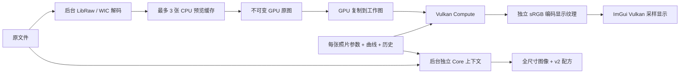

# Studio 编辑器

Studio 的当前交付目标是可持续编辑照片的工作流：大画布、直观控制、可撤销的参数状态、GPU 预览，以及与 CLI 共用的配方。它借鉴 RAW 编辑器的布局，不复制 ACR 的私有算法，也不把数值范围伪装成 ACR 参数。

## 实际架构



主窗口持有 Vulkan instance、device 和 graphics+compute queue，Core 通过 `IBP_CreateSharedVulkan` 借用这些对象。Core 释放自己的资源，但不销毁借用的设备。调用者必须串行安排外部 queue 使用；在修改或释放已暴露的图像视图前，应保证外部读取已经结束。

当前照片保留四个 Core 图像句柄：原图、工作图、原图显示、编辑后显示。每次调整先执行 `IBP_CopyImage` 恢复工作图，再运行相同的处理流水线，因此编辑不会累积到上一次结果。显示纹理经 `IBP_EncodeDisplay` 编码为 sRGB 后直接供 Vulkan 渲染使用，不进行 GPU 图像下载或 JPEG 往返。

Core 每个句柄内部仍分配双 RGBA32F 图像，Studio 没有专门的轻量单缓冲纹理分配器。2048×1363 的四个句柄仅像素存储约 341 MiB；加上原图 CPU 缓存、缩略图、导出、驱动和中间缓冲，实际占用更高。缩略图按可见项延迟加载，已加载 GPU 缩略图在本次会话保留；这不是无上限图库浏览器。

## 交互与状态

| 操作 | 行为 |
| --- | --- |
| 滑块拖动 / 数值拖动 | 即时更新预览，释放时合并成一条历史 |
| Ctrl+单击数值 | 键盘输入；值限制在当前控件范围 |
| 双击滑块 | 恢复该项默认值 |
| 曲线单击 / 拖动 | 添加或移动节点；固定端点横坐标 |
| 曲线右键 | 删除最近的内部节点；不能删除端点 |
| Ctrl+Z / Ctrl+Y | 当前照片撤销 / 重做 |
| 滚轮 / 空格拖动 | 围绕鼠标缩放 / 平移画布 |
| 按住反斜杠 | 临时显示原图 |
| 前后分割 | 左原图、右调整后，可拖动分界 |
| Ctrl+单击胶片 | 多选；配方菜单同步当前调整 |
| 工作区 → 重置布局 | 恢复默认停靠布局 |

每张照片最多保留 80 个内存历史状态。最终参数自动保存到 `SDL_GetPrefPath("ImageBatchProcessor", "Studio")/sessions/`，以规范化绝对路径的 FNV-1a 64 位哈希命名；哈希用于查找，不是加密或身份认证。跨次运行恢复最终调整，未保存完整撤销历史。移动源文件会改变关联键。

“自动调整”基于原预览统计更新基础参数，曲线仍保留；“自然”预设同时重置曲线。“全重置”恢复默认参数及曲线。导入配方影响当前照片，同步功能需要显式选择其他照片。

## 预览与输出约定

RAW 预览先进行半尺寸解码，再缩小到最长边 2048。CPU 解码与全尺寸导出在后台线程执行，预览 GPU 调用仍在主线程同步完成。拖动时约每 40 ms 最多提交一次，单次复杂滤镜可能更慢；不承诺固定帧率。停止操作后更新分析直方图。

预览的 100% 是预览纹理的像素比例。像素邻域滤镜（锐化、降噪、清晰度、颗粒）以及几何重采样在预览和原尺寸上可能不同。当前不提供原图 1:1 区域预览。

导出从原文件全尺寸解码，使用独立 Core 上下文，依次处理所选照片。导出期间采用启动时的参数快照，继续修改 GUI 不会改变已排队快照。图片保存禁止覆盖已有文件，配方紧随成功图像写入；图像和配方不是整体原子事务。取消在照片之间检查，不能中断当前照片的解码/处理/编码。

v2 配方保存控制点和 LUT，CLI 可按原始输入复现同一流水线：

```powershell
.\bin\imgbp.exe batch --input photo.NEF --output Replay --target photo.imgarg --fixed --quality 95
```

应使用相同原图、输出格式/质量、程序版本和设备进行一致性比较。跨 GPU 的浮点与颗粒三角函数近似可能不同。

## 本阶段边界

已经实现的界面模块包括光线、颜色、曲线、8 区颜色混合、细节、几何、效果、预设/历史、批量同步和导出。Core 中的所有参数并非都已映射到 Studio 控件。

图形蒙版工具、画布裁剪/拉直、白平衡取样器、原尺寸局部预览、输入/显示器 ICC 转换以及 Linux/macOS Core I/O 移植留待后续阶段。当前显示编码使用 sRGB，不能当作经过显示器校准的专业软打样。

Dear ImGui 和 SDL 的跨平台能力只是基础；系统对话框、字体、输入、显示色彩与 GPU 驱动仍需逐平台验证。原 WinForms 工具保留，以便使用已有 v1 工作流。
